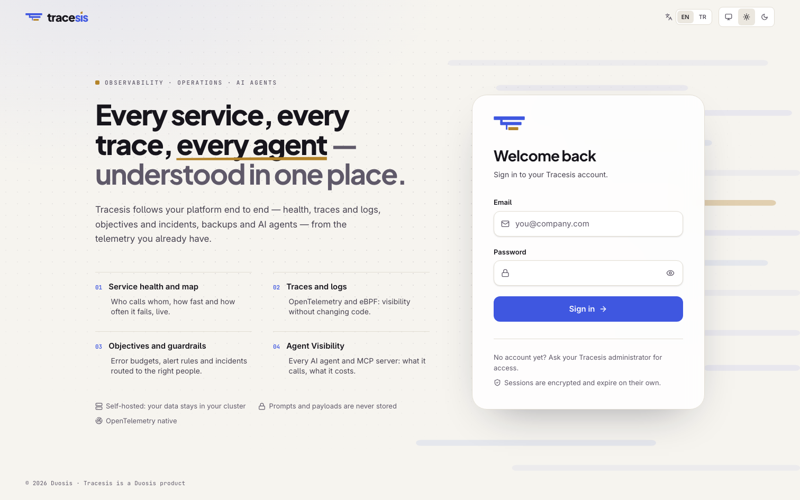
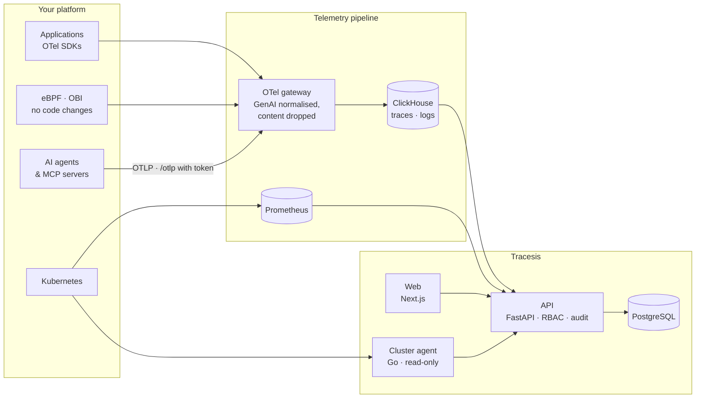

<p align="center">
  <picture>
    <source media="(prefers-color-scheme: dark)" srcset="docs/assets/readme/tracesis-mark-dark.svg">
    
  </picture>
</p>

<h1 align="center">Tracesis</h1>

<p align="center">
  <strong>See every service, every trace — and every AI agent.</strong><br>
  An observability and operations control plane for Kubernetes platforms, built on the telemetry you already have.
</p>

<p align="center">
  <a href="https://github.com/Duosis-Developer-Team/Tracesis/actions/workflows/ci.yml"></a>
  
  
</p>

<p align="center">
  
</p>

---

## What Tracesis does

Tracesis turns metrics, traces, logs and cluster inventory into one picture of a
platform — organised by **project, environment and service**, not by dashboard.

| | |
|---|---|
| **Service health and topology** | Golden signals per service, a live service map (who calls whom, how fast, how often it fails), deployments correlated with change. |
| **Traces and logs** | OpenTelemetry and eBPF (OBI) feed a ClickHouse store: request waterfalls, log search and patterns — visibility without changing application code. |
| **Objectives and incidents** | SLOs measured from traces with error budgets and burn rates, alert rules with anomaly bands, incidents with a lifecycle, and routed notifications. |
| **Infrastructure and protection** | Cluster inventory from a read-only agent, resource usage, and backup posture that never mistakes "a backup exists" for "a restore works". |
| **Agent Visibility** | Every AI agent found on first sight — no registration: its runs step by step, the models and tools it reaches, MCP servers and their clients, cost at list prices, guardrails that page, and governance (owner, purpose, approval, shadow AI). |
| **Catalog from source** | A GitHub App onboards repositories into the catalog from a reviewed manifest, so what Tracesis knows comes from where the code lives. |

## How it works



**Principles that do not bend**

- The browser talks to one thing: the Tracesis API. It never reaches Prometheus, ClickHouse, Alertmanager or the Kubernetes API.
- Queries are repository-owned templates. Users cannot submit PromQL or SQL.
- The cluster agent is read-only (`get` / `list` / `watch`), never sees Secrets, never gets `exec`.
- Prompts, model answers and tool arguments are removed at the gateway. Tracesis keeps names, counts and timing.
- Unknown is shown as unknown — never silently converted to zero or "healthy".
- Every write is scoped by role and recorded in an append-only audit log.

## Repository layout

```text
apps/
  web/            Next.js UI (EN/TR, light/dark)
  api/            FastAPI control plane, migrations, background loops
  worker/         Background job runner
  cluster-agent/  Go read-only Kubernetes inventory agent
packages/
  contracts/      JSON Schemas, fixtures and the validator CLI
deploy/
  drake/          Helm chart for Tracesis itself
  otel/           OpenTelemetry gateway, agents, OBI and ClickHouse
  agent/          The cluster agent's chart
  edge-tls/       Certificate for the public edge
  local/          Local-only Docker Compose stack
docs/
  adr/            Architecture decision records
  runbooks/       Operating procedures
```

> Tracesis was called **Drake** while it was being built. Python packages, image
> and chart names (`drake_api`, `drake-api`, `deploy/drake`) keep that name; the
> product, the UI and the repository are Tracesis.

## Getting started

Prerequisites: Node.js (see `.nvmrc`), pnpm, Python 3.13 with
[uv](https://docs.astral.sh/uv/), Go (see `apps/cluster-agent/go.mod`) and Docker.

```bash
pnpm install          # JS/TS workspaces
uv sync               # Python workspaces (api, worker)
make up               # local PostgreSQL, Redis, ClickHouse, Prometheus, OTel collector
make test             # every test suite
make down             # stop the local stack (keeps data)
```

Development happens against the local stack; nothing here connects to shared or
production infrastructure. `scripts/ci_job.sh <job>` runs any CI job locally
(`python`, `web`, `chart`, …).

## Deploying

Tracesis ships as container images and Helm charts. A release pins image digests
in the environment's values, takes a database backup, previews with a dry run and
rolls out — see [`docs/runbooks/`](docs/runbooks/) and the chart under
[`deploy/drake/`](deploy/drake/). Connecting an agent or an OpenTelemetry-instrumented
service takes environment variables, not code: **Agents → Connect an agent** shows
the exact values for a deployment.

## Documentation

- [Architecture decision records](docs/adr/)
- [Runbooks](docs/runbooks/) — alerts and SLOs, incidents, GitHub App onboarding, the cluster agent
- [CI and test policy](docs/CI_AND_TEST_POLICY.md)

<p align="center"><sub>Tracesis is a Duosis product.</sub></p>
